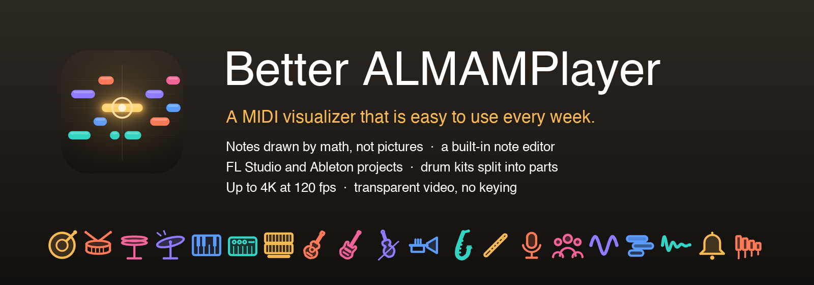

  
  
  

**Better ALMAMPlayer** turns a MIDI file into a scrolling note video. It is a fork of
[almam's ALMAMPlayer](https://github.com/almam72/ALMAMPlayer), rebuilt so it is easy enough to use every week:
open a song, tweak the look, fix the notes, and export.

## What's new

- **Everything is drawn, nothing is a picture.** Notes are rounded shapes with a soft highlight and a glow while they play; there are no note or effect images to go wrong.
- **Track icons that show on every hit.** More than 100 drawn instrument icons (every drum piece, keys, guitars, strings, brass, winds, voices, synths, FX…). Each note hit draws the track's own icon at the playhead. Icons are picked from the track name or instrument, and you can choose your own with a searchable picker.
- **A note editor.** Select, move, resize, add and delete notes in a piano roll, with snapping, velocity, undo and redo. Click a piano key to select every note of that pitch and clear a keyswitch in one go. Your file is never changed: edits are saved with the song, and you can save a fixed MIDI.
- **Drum kits split into parts.** A drum track (MIDI channel 10) is split into kick, snare, hats, toms, cymbals… on its own, shown as dots. Split any track by pitch, merge it back, add empty tracks, remove tracks, rename them.
- **Open projects directly.** MIDI, **FL Studio** (`.flp`) and **Ableton Live** (`.als`) projects open with every track found by itself.
- **Transparent video.** Export a `.mov` (ProRes 4444 with alpha) and drop the notes straight onto other footage, with no keying.
- **Up to 4K at 120 fps.** 1080p, 1440p or 4K; 24, 30, 60 or 120 fps; wide or square (1:1, and the preview crops to match).
- **Exact timing.** Every frame is drawn from the song position, so the picture and the audio always agree, and seeking is instant.
- **No save button.** Settings are kept per song, by track name, and saved as you go. Drag tracks to reorder them: the top track draws in front.
- **Note-off velocity** is read and used in the velocity effect, so a hard release lets go sooner.

## Download

Get the latest build from [Releases](https://github.com/Prod-DJD/BetterALMAMPlayer/releases/latest):

| Platform | File | Notes |
|---|---|---|
| macOS (Apple silicon and Intel) | `Better-ALMAMPlayer-…-macOS.zip` | Not notarized: right-click the app, choose **Open**, then **Open** again. Includes ffmpeg. |
| Windows (64-bit) | `Better-ALMAMPlayer-…-Windows.zip` | Video export needs ffmpeg on your PATH (`winget install ffmpeg`). |
| Linux (64-bit) | `Better-ALMAMPlayer-…-Linux.tar.gz` | Unzip, make it executable, run it. Video export needs ffmpeg (`sudo apt install ffmpeg`). |
| iOS (jailbroken devices) | `Better-ALMAMPlayer-…-iOS-jailbreak.ipa` | Signed ad hoc, not by Apple: install it with your jailbreak's installer. Video export isn't available on iOS. |
| Android 7.0+ (arm64) | `Better-ALMAMPlayer-…-Android.apk` | Allow installing from your browser or files app. Video export isn't available on Android. |

Video export needs ffmpeg, which can't run inside an iOS or Android app, so phones and tablets can open, edit and play songs but not export video.

## Using it

1. Drop a `.mid`, `.flp` or `.als` on the window (or **Open…**). A sound file with the same name beside it (`song.mid` + `song.mp3`) is picked up too. Anything else you drop is understood by its type: sound becomes the audio, a picture the background.
2. Colors, shapes, icons and speed are on the left (per track) and right (the scene). Space plays and pauses, the arrow keys jump 5 seconds, **Tab** switches to the note editor.
3. **Export video…** writes an `.mp4`, or a `.mov` with a transparent background.

| Opens | How |
|---|---|
| MIDI (`.mid`, `.midi`) | directly |
| FL Studio (`.flp`) | every channel with notes becomes a track, placed where the playlist puts it. The first tempo is used throughout; audio clips and plugin sounds aren't read |
| Ableton Live (`.als`) | MIDI clips from the arrangement, looped clips repeated. The set's tempo is used throughout |
| Logic Pro (`.logicx`) | the project folder itself: every MIDI track in the arrange, in its order. Tempo changes and audio regions aren't read; the first tempo is used throughout |

## Build from source

You need [Godot 4.7](https://godotengine.org). Open the project and run it, or on a Mac run
`tools/build_macos.sh` (see the comments in it for ffmpeg), or export Windows, Linux or iOS from Godot. Video export needs ffmpeg: the Mac build bundles it,
otherwise it is found on your system (for example `brew install ffmpeg`). Tests and developer notes are in
[docs/DEVELOPMENT.md](docs/DEVELOPMENT.md).

## Credits

- **ALMAMPlayer** by [almam](https://github.com/almam72), with contributions from speaksy and yohannd1: this project is built on their work.
- The MIDI parser is from [godot-midi-player](https://github.com/arlez80/godot-midi-player) by arlez80.
- The Logic Pro reader is ported from the MIT-licensed LogicBridge in the FLP to Logic converter (Jon Kubis), see [licenses/LogicBridge-MIT.txt](licenses/LogicBridge-MIT.txt).
- Video is written with [FFmpeg](https://ffmpeg.org); the engine is [Godot](https://godotengine.org).
- Better ALMAMPlayer by DJ D.

## License

GPLv3, like the original. See [LICENSE](LICENSE) and [licenses/](licenses/). Contributions are welcome: see [CONTRIBUTING.md](CONTRIBUTING.md).
